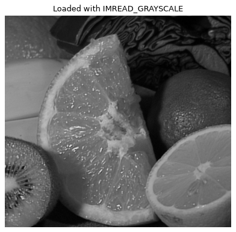
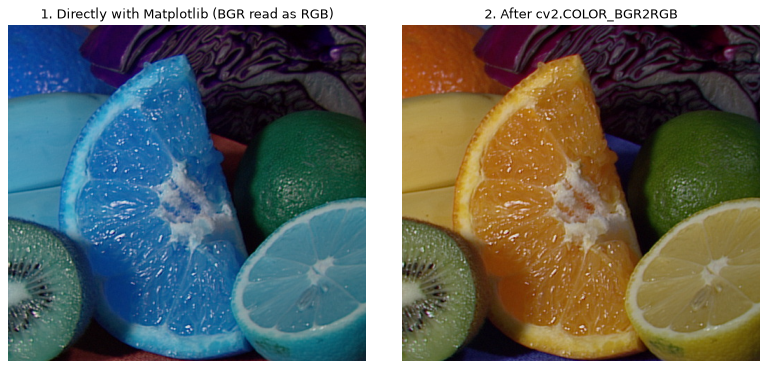
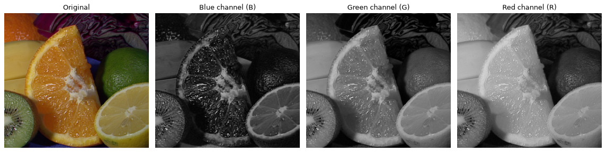
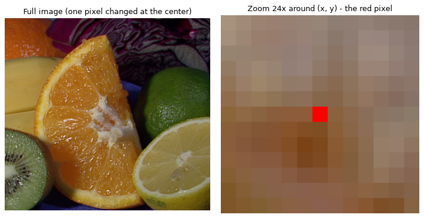
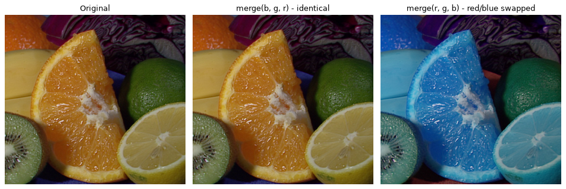
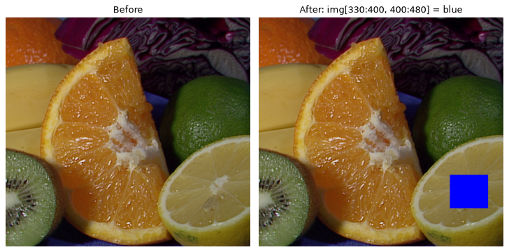

# Computer Vision — Section 1 Exercises (OpenCV Fundamentals)

[](https://colab.research.google.com/github/amr-elgharip2006/cv-section1-opencv-fundamentals/blob/main/CV_Section1_Solutions.ipynb)


**Course:** Computational Vision — Section 1 (Eng. Aya Motawea)
**Topic:** Introduction to images & OpenCV: the image as a matrix, pixels, channels, `uint8`, coordinates
**Student:** Amr Ahmed Elgharip

> حل الـ 7 Exercises بتوع Section 1، وتمرين السلايد 14، والـ Starter template.

> ⚡ **Solutions only:** [`CV_Section1_Solutions.ipynb`](CV_Section1_Solutions.ipynb) — the Colab badge opens this one. The full section notebook with the solutions at the end is kept too.

The solutions are in [`CV_Section1_Exercises_Amr.ipynb`](CV_Section1_Exercises_Amr.ipynb), under **"Solutions — Amr"** at the end of the notebook.
They use OpenCV's sample image **`fruits.jpg`**, which is downloaded automatically, so the notebook runs in Colab **without an upload**.
All outputs are saved, so you can read the notebook directly on GitHub.

---

## Exercises at a glance

| # | Exercise | Result |
|---|---|---|
| 1 | **Matrix inspection** | Grayscale image: shape `(480, 512)`, `ndim` 2, `uint8`, min 0, max 238, mean 88.66. Explains why grayscale has 2 dimensions (one value per pixel). |
| 2 | **`imread` flags** | COLOR → `(480, 512, 3)`, GRAYSCALE → `(480, 512)`, UNCHANGED → `(480, 512, 3)` for the JPG but **`(480, 512, 4)`** for a PNG with an alpha channel. |
| 3 | **RGB / BGR** | Shows the image without and with `COLOR_BGR2RGB`. Without it, red and blue are swapped (the orange turns blue). |
| 4 | **Channels** | `cv2.split()` into B, G, R, each shown in grayscale, and what a bright region means in each channel (mean B ≈ 46 < G ≈ 86 < R ≈ 111). |
| 5 | **`uint8`** | `[0, 100, 200, 255] + 20` → `[20, 120, 220, 19]` (wrap-around). Safe version with `int16` + clipping → `[20, 120, 220, 255]`. Bonus: `cv2.add` saturates on its own. |
| 6 | **Coordinates** | BGR values at the top-left, center and bottom-right (`img[y, x]`), then one pixel changed to red and shown with a 24× zoom. |
| 7 | **Reconstruct** | `cv2.merge(cv2.split(img))` → `np.array_equal` is **True**. Merging in the wrong order (r, g, b) gives **False**. |
| ★ | **Slide 14 exercise** | A small region set to a solid color, with the pixel printed before and after. |
| ★ | **Starter template** | All five TODOs completed. |

---

## Results

### Exercise 1 — Grayscale matrix


### Exercise 3 — BGR shown as RGB vs converted


### Exercise 4 — B, G, R channels


### Exercise 6 — Changing one pixel


### Exercise 7 — Split + merge


### Slide 14 — Modify a region


---

## Run it

- **Colab:** click the badge above → *Runtime → Run all*.
  (The upload cells from the section are optional; the solutions don't need them.)
- **Locally:**

  ```bash
  pip install opencv-python numpy matplotlib jupyter
  jupyter notebook CV_Section1_Exercises_Amr.ipynb
  ```

---

The section notebook *"Computer Vision with OpenCV: Fundamentals and Function Mastery"* is by the course TA. The exercise solutions are my own work.
Sample image: `fruits.jpg` from the [OpenCV samples](https://github.com/opencv/opencv/tree/4.x/samples/data).
